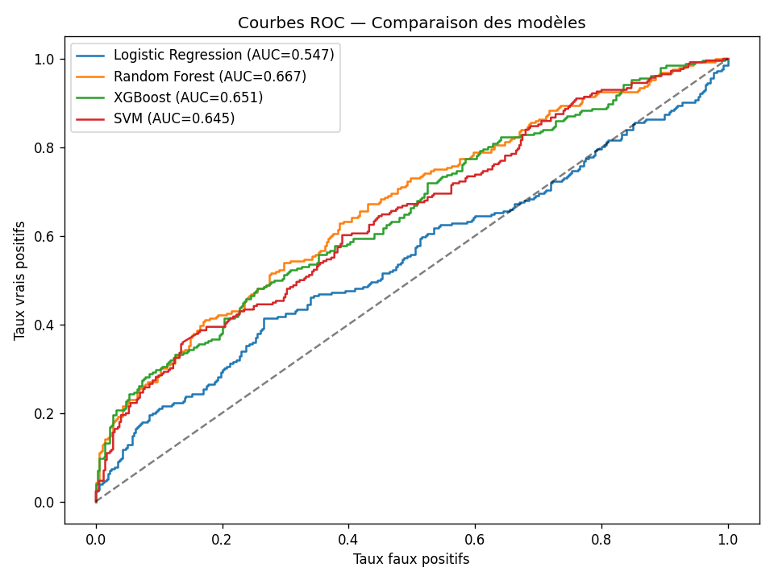
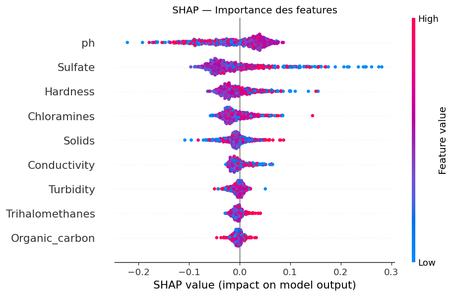

# 💧 Water Potability Prediction

An end-to-end machine learning project predicting whether a water sample is safe to drink from its physico-chemical properties, from exploration to a deployed app.

🔗 **Live app:** [projet-potabilite-eau.streamlit.app](https://projet-potabilite-eau-667gnpnfdko4imxs5vgx8a.streamlit.app/)

## Problem

Lab testing is not always available in the field. Can a model flag potentially unsafe water from 9 measurements (pH, hardness, solids, chloramines, sulfate, conductivity, organic carbon, trihalomethanes, turbidity)?

**Data:** [Water Potability dataset (Kaggle)](https://www.kaggle.com/datasets/adityakadiwal/water-potability), ~3,300 samples, imbalanced classes, missing values.

## Pipeline

| Step | Script | What happens |
|---|---|---|
| 1. EDA & cleaning | `1_eda.py` | Distributions, correlations, outliers, class balance, missing-value imputation |
| 2. Modelling | `2_modeling.py` | Logistic Regression, Random Forest, XGBoost and SVM compared (AUC, F1, 5-fold CV) with an overfitting diagnostic |
| 3. Optimisation | `3_optimization.py` | Decision-threshold tuning, SHAP explainability, cross-validation |
| 4. App | `app.py` | Streamlit interface for field use |

## Results

| Model | Test AUC | F1 | CV F1 |
|---|---|---|---|
| **Random Forest** (selected) | **0.67** | 0.51 | 0.53 |
| XGBoost | 0.65 | 0.49 | 0.52 |
| SVM | 0.64 | 0.49 | 0.55 |
| Logistic Regression | 0.55 | 0.47 | 0.44 |

After threshold tuning (0.49): **F1 = 0.54**, 5-fold CV AUC **0.69 ± 0.02**.

**Takeaways**
- Linear models fail (AUC ≈ 0.55): the relationship between features and potability is non-linear.
- Tree models overfit strongly (train AUC ≈ 0.98), which the diagnostic step makes visible. Moderate scores are expected on this dataset, where the features overlap heavily between classes.
- SHAP shows which measurements drive each prediction, which matters for a safety-related decision.

<p align="center">
  
  
</p>

## Run it

```bash
pip install -r requirements.txt
python 1_eda.py
python 2_modeling.py
python 3_optimization.py
streamlit run app.py
```

Also included: `Rapport_ML.pdf` (full report) and `Projet_H2_Potabilite_Eau.pptx` (presentation).

## Tech

Python · Pandas · scikit-learn · XGBoost · SHAP · Matplotlib · Seaborn · Streamlit

---

**Solange Ilinga** · [LinkedIn](https://linkedin.com/in/solange-ilinga)
